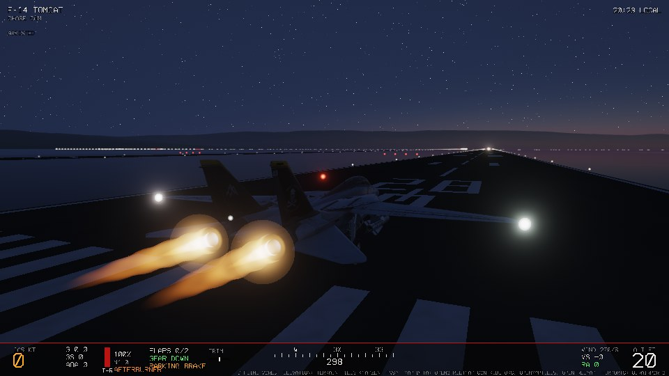
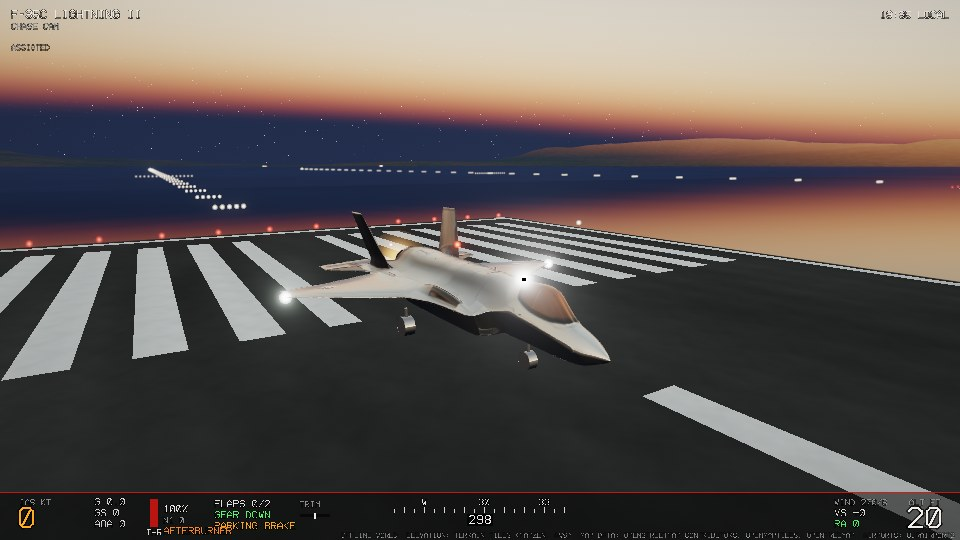
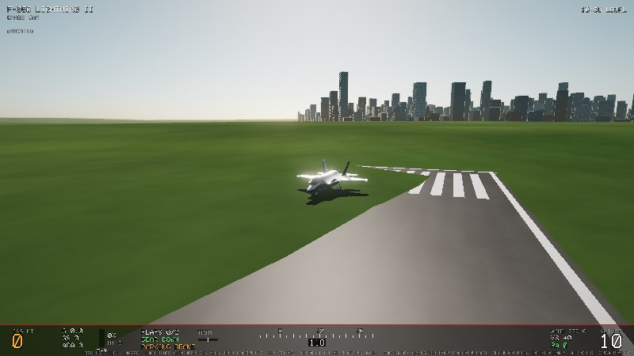
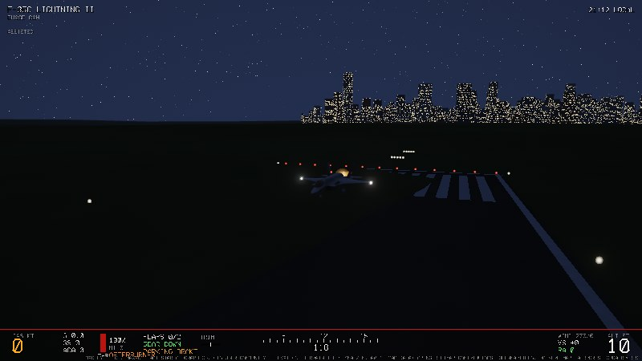
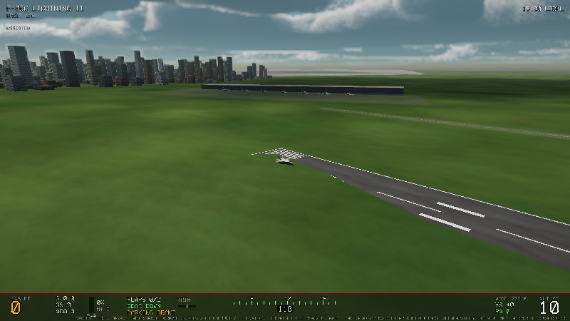
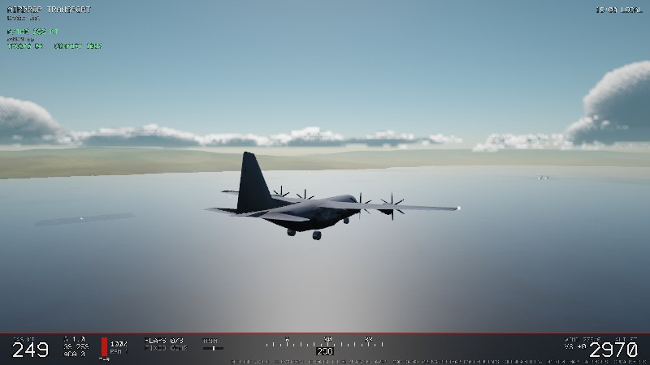

# WINGMERE

**A free, open-source flight simulator over the whole real Earth.** Pick any of 9,313 real airports and fly anywhere. Satellite imagery, terrain and OpenStreetMap data stream in while you fly: real coastlines, lakes and rivers, 3D buildings in every city with lit windows at night, real taxiways and terminals, and roads that glow after dark. Every runway has its real numbers, lights and PAPI, and the sun, clouds and stars follow the real time of day.

Written in C with SDL2 and OpenGL 3.3, for every Linux distro. MIT licence.


| | |
|---|---|
|  |  |
|  |  |
|  |  |
|  |  |

*These were rendered on a build machine with no access to the real tile servers, so the ground, imagery and buildings come from the built-in offline world and a local test server (`tools/fake_tile_server.py`). Online, you get real satellite imagery, terrain and OpenStreetMap data.*

## What's in it

- **The real planet, streamed.** A quadtree over the whole Earth in WGS84 double precision, with camera-relative rendering so there's no jitter anywhere, logarithmic depth for a 30 cm to 400 km view, and horizon culling. Imagery and elevation download on background threads, get cached in `~/.cache/wingmere`, and fall back to a procedural world when you're offline.
- **A steadier camera.** The chase view follows your flight path, lags a touch behind turns so corrections don't shake it, frames the aircraft low with the view ahead open, rises a little on final, and eases over terrain instead of jumping; frame pacing evens out clock wobble.
- **Sharper ground, sooner.** Tiles where you will be in half a minute (longer in time warp) are fetched before you get there, with more download workers, a bigger texture budget and faster uploads.
- **Landings that feel like an aeroplane.** Oleo-pneumatic landing gear with real stroke (an air spring that stiffens as it closes, oil damping that soaks up the arrival and stops it springing back), each wheel carrying its real share of the weight, tyres that grip by slip angle instead of sticking like glue, automatic ground spoilers on airliners, and assisted controls that hand the flare back to you gently on touchdown and settle a bounce instead of floating away. Carrier jets (F-35C, F-14) have long-stroke carrier gear. `wingmere --test-landing` prints touchdown rate, peak g and bounce for every aircraft.
- **Every real plane in the world, where it really is, right now.** A snapshot of every aircraft the [OpenSky Network](https://opensky-network.org) is tracking worldwide (10,000-15,000 at a time) arrives every couple of minutes, and the [adsb.lol](https://adsb.lol) ADS-B feed adds full detail (type, registration, operator, autopilot settings) every 8 seconds for everything within about 80 NM of you, or of the plane you are watching. Between reports every aircraft keeps flying on its real track, speed and climb rate. They are all in the world: fly, teleport or watch anywhere and the real traffic is there.
- **Their own airframes, in their airline's colours.** Live traffic is built from each type's real dimensions (`data/types.txt`, ~130 types from the Cessna 172 to the A380): fuselage length and width, swept or straight wings, low or high wing, T-tail, winglets, twin, three or four engines under the wings, on the tail or as propellers, landing gear that comes down for landing. Each is painted in its airline's colour scheme (`data/liveries.txt`, ~80 airlines plus regional partners): belly, cheatline, tail colours, engines, cabin windows spaced for the type. Colours only: logos, names and titles are the airlines' trademarks and are not included. Both tables are plain text, so add or correct whatever you like.
- **Escort missions (I).** Pick any real aircraft in the tracker and press I: you scramble in a fast jet from the nearest long runway in the same country, follow the intercept cue (lead pursuit on its real track), match its speed and height, slide onto its right wing, and escort it until it leaves that country's airspace (real borders from Natural Earth, plus 12 NM of territorial sea; the map shows the border and where it will cross). You are scored on how much of the escort you held formation. Y engages a formation-keeping autopilot, and Tab time-warps the long part: real aircraft fly in real time, so during warp it is predicted ahead along its filed route (or its track) with you carried beside it, and the card says so.
- **Fly a real flight's route (O).** On a tracked scheduled flight, O starts you on the runway at its real departure airport with a magenta route line to its destination on the map and in the sky, a steering cue, distance and ETA. Y engages autopilot NAV: it climbs at a sensible speed (climb power, never trading speed for height), cruises near Mach 0.78 in jets, starts down on a 3-degree path and hands the aircraft back about 12 NM out at around 4,000 ft for you to land.
- **Plane tracker (K).** A list of every aircraft in the world, nearest first, with a search box (/) for callsign, registration, type, hex code or country, and a live count. Pick one (click it, click it on the map, or N for the nearest) to get its card: a real photo of that exact airframe ([Planespotters](https://www.planespotters.net), else [airport-data](https://airport-data.com) via [adsbdb](https://www.adsbdb.com)) credited to its photographer, the airline, where it took off and where it is going with how far along it is and an ETA, what it is doing (taxiing, climbing, cruising, on approach), altitude, cleared altitude, vertical speed, speed, Mach, track, squawk (emergencies flash), aircraft type, registration, owner, and its trail on the map and in the sky. J watches it from an orbiting camera anywhere on Earth while your own aircraft waits; Shift+J puts you on its wing at its height, heading and speed.
- **Go anywhere, poles included.** The world map (M) pans and zooms out to the whole planet: click anywhere to teleport there. Time warp goes up to ×64 in cruise (Tab), so an ocean crossing takes minutes. The Arctic is sea ice you can land on, Antarctica is a 2,900 m ice plateau, and the dateline and both poles fly straight through. *Fly from another airport* in the pause menu jumps to any of the 9,313 airports. The sun follows today's real date.
- **Every real airport.** 9,313 airports and 12,530 runways from OurAirports. Runways get centrelines, piano keys, aiming points, touchdown-zone bars and their real designators (28R, 09L…), the terrain under them is levelled, and at night the edge, threshold and approach lights come on, including a sequenced-strobe "rabbit". A PAPI shows white/red against your real glide angle.
- **Real map data for the whole world.** OpenStreetMap vector tiles (OpenFreeMap, no key needed) give exact coastlines, lakes and rivers (also used by the physics, so low land is not "sea"), extruded 3D buildings with facades, glass towers and lit windows at night, painted aprons and taxiways with yellow centrelines and green centreline lights, and street lights along every road at night.
- **Airports that look lived in:** buildings on the edge of an apron become glass-fronted terminals and hangars, and airliners in assorted liveries park at the stands.
- **Weather that looks like weather:** raymarched cumulus with flat dark bases, bright billowing tops, silver linings and multiple scattering, and their shadows drift across the ground, the buildings and your aircraft.
- **Sharper mountains:** terrain is lit per pixel from the elevation data, now fetched one zoom level deeper, so ridges and gullies stay crisp.
- **Choose your imagery:** Esri World Imagery (sharp, ~1 m), Sentinel-2 cloudless (10 m, open data) or USGS (USA only).
- **Seven aircraft**, each with its own flight model and landing gear: Yellow Biplane, F4U Corsair, F-117 Nighthawk, F-35C Lightning II, F-14 Tomcat, Airdrop Transport (four turboprops) and a 737 MAX 8. The F-35 and F-14 light their **afterburners** (the last tenth of the throttle) with shock-diamond flames.
- **Landing made easy:** flight assists (on by default) turn the stick into a fly-by-wire control that holds attitude, trims itself and coordinates turns, with stall protection. On approach you get autothrottle, a 3D glide-path "highway in the sky", ILS needles, radio-altitude callouts, a FLARE cue, autobrakes, and forgiving landing gear.
- **Hangar:** repaint any aircraft (12 colours from factory to black metal), pick a finish (matte, gloss, chrome, satin metal) and a smoke colour for airshow smoke (X).
- **People on board:** pilots you can see in the cockpit (helmets in the jets, leather caps and goggles in the old planes). The 737 carries 186 passengers and the transport 64 troops. They react to g-forces, steep banks and stalls, scream when it gets scary, clap at a smooth landing, and leave you a star rating with a review.
- **Six-degrees-of-freedom flight model.** Lift with a real stall and post-stall, induced and transonic drag, flaps and gear drag, thrust that fades with speed and altitude, prop wash, stability derivatives, sprung, braked, steerable landing gear, wind with gusts and turbulence, and crash detection (hard landings, wingtip strikes, gear-up landings, ditching).
- **Graphics:** physically based aircraft materials with normal maps, a single-scattering atmosphere baked into a sky cubemap in your local frame, aerial perspective, raymarched volumetric cumulus, aircraft shadows on the ground, water with sky reflections and sun glint, stars, city lights at night, contrails above 8,200 m, tyre smoke, bloom, lens flare, eye adaptation and ACES tone mapping.
- **Landing challenges** scored out of 1,000 on sink rate, centreline, touchdown zone and alignment: Maho Beach, Lukla, Saba, Gibraltar, Madeira, Innsbruck, Paro, Queenstown, Aspen, San Francisco at dawn, Hong Kong at night, and a 22-knot crosswind at Heathrow. Best scores are saved.
- **Every touchdown is rated** (feet per minute, BUTTER to CARRIER STYLE), with distance past the threshold and centreline offset.
- **Glass-cockpit HUD** with a pitch ladder and flight-path marker in the pilot view, ILS-style localizer and glideslope to whichever runway you're lined up on, a terrain warning, stall horn, autopilot (heading, altitude, speed), a satellite map (M), six cameras, and all sound synthesised live (radial engines, turboprops, jets, wind, tyres).
- Keyboard, gamepad (SDL game controllers) and joystick/HOTAS (pitch, roll, throttle and rudder axes).

## Install

```sh
git clone https://github.com/rxvy-dev/wingmere
cd wingmere
./install.sh              # installs build dependencies, builds, installs to ~/.local
wingmere
```

`./install.sh --system` installs to `/usr/local`, and `--no-deps` skips the package step. The installer knows apt, dnf, pacman, xbps, zypper, apk, emerge and eopkg. To build by hand you need a C compiler, CMake, pkg-config and the development files for SDL2, OpenGL, libcurl and zlib:

```sh
cmake -S . -B build -DCMAKE_BUILD_TYPE=Release
cmake --build build -j
./build/wingmere          # finds ./data on its own
```

It needs a GPU with OpenGL 3.3. Scenery downloads the first time you fly over a place, usually a few tens of megabytes per area, and loads from the cache after that.

## Controls

| Key | Action |
|---|---|
| W S / ↑ ↓ | pitch (S pulls the nose up) |
| A D / ← → | roll |
| Q E | rudder and nosewheel steering |
| R F / PgUp PgDn | throttle; `1`–`9`, `0` set 10–100 %, `` ` `` idle |
| G | landing gear |
| V / B | flaps down / up |
| Space | brakes (Shift+Space toggles the parking brake) |
| , . | trim nose down / up |
| Z | autopilot on/off; while it's on, the flight controls adjust its targets |
| Shift+Z | autothrottle on/off; R/F then set its speed |
| X | airshow smoke |
| C, F2–F7 | cameras: chase, pilot, tail, orbit, tower, flyby |
| right mouse drag, wheel | look / orbit, zoom |
| M | map (+/- zoom) |
| P | pause |
| Tab, Shift+Tab | sim rate ×2 and ×4 (full physics), then time warp ×8 to ×64 in cruise (300 m above the ground or more) |
| L | live traffic labels on / off |
| K | plane tracker: every aircraft in the world (wheel scrolls, / searches, click to track) |
| N, Shift+N | track the next / previous nearest aircraft |
| J, Shift+J | watch the tracked aircraft / fly on its wing |
| Del | stop tracking |
| I | escort the tracked aircraft out of the country (scramble) |
| O | fly the tracked flight's route from its departure airport |
| Y | autopilot NAV: follow the route, or hold formation in an escort |
| M | world map: wheel or +/- to zoom, drag to pan, **click to teleport** |
| T / Shift+T | time of day ±15 min |
| H, F3, F1 | hide HUD, FPS counter, controls help |
| F12 | screenshot to ~/Pictures |
| Esc | menu |

**Gamepad:** left stick flies, triggers set throttle, shoulder buttons are the rudder, A = gear, B = brakes, X/Y = flaps, D-pad = trim, Back = camera, Start = pause, left-stick click = autopilot.

**First flight:** pick FREE FLIGHT with the Corsair at KSFO. Press `0` for full power and the parking brake releases itself. Keep straight with Q/E, and at about 100 knots hold S to lift off. Press G to raise the gear. With assists on, let go of the keys and the plane holds its attitude.

**First landing:** set START to ON FINAL APPROACH. The autothrottle holds the approach speed. Keep the aircraft inside the green gates (magenta means you're off the path), and use small taps of W/S. At the FLARE call, hold S gently, and the autobrakes stop you after touchdown.

## Command line

```
wingmere --airport LOWI --runway 26 --aircraft b737 --start approach --time 17.5 --weather 2 --wind 260/12 --fly
wingmere --challenge 1          # Maho Beach
wingmere --offline              # procedural world, no downloads
wingmere --aircraft b737 --pos -87.5,20,3600,180   # in the air anywhere: lat,lon,altitude m,heading
wingmere --track a1b2c3 --escort a1b2c3          # start an escort of that aircraft (ICAO hex) as soon as it shows up
wingmere --help                 # everything else
```

## Settings

`~/.config/wingmere/wingmere.cfg` is written when you quit, or change something in SETTINGS. Things worth knowing:

```
detail = 1.0                 # terrain detail, 0.5 - 2.5
imagery_max_zoom = 14        # Sentinel-2 is 10 m per pixel, which is zoom 14
elevation_max_zoom = 13      # 12 downloads less; 14 is sharper still
texture_budget = 1536        # satellite tiles kept on the GPU
threads = 6                  # download threads
imagery = 0                  # 0 Esri World Imagery, 1 Sentinel-2 cloudless, 2 USGS (or set it in SETTINGS)
imagery_url = ...            # optional: your own XYZ imagery server instead
elevation_url = https://s3.amazonaws.com/elevation-tiles-prod/terrarium/{z}/{x}/{y}.png
vector_tilejson = https://tiles.openfreemap.org/planet
buildings = 1
assist = 1                   # flight assists
guide = 1                    # 3D approach gates
traffic = 1                  # live air traffic (also in SETTINGS)
traffic_labels = 1
traffic_url = https://api.adsb.lol/v2/lat/{lat}/lon/{lon}/dist/{dist}
traffic_global = 1           # every aircraft in the world (OpenSky Network)
global_interval = 150        # seconds between world snapshots
# opensky_client_id = ...    # optional OpenSky API client: ten times the daily allowance, snapshots every 15 s
# opensky_client_secret = ...
```

Without an account OpenSky allows 400 credits a day and a world snapshot costs 4, so one every 2.5 minutes covers a long session; if the day's allowance runs out the game waits and keeps flying everyone on their last known track. A free [OpenSky account](https://opensky-network.org) with an API client raises it tenfold.

Live traffic is polled every 8 seconds from a free community service, so please keep it that way. Any server that answers in the same ADSBExchange-v2 JSON format (an `ac` list with `hex`, `flight`, `r`, `t`, `lat`, `lon`, `alt_baro`, `gs`, `track`, `baro_rate`) works, including your own `readsb` or `tar1090` receiver at home. adsb.lol says a feeder-issued API key may be needed in future; if the feed ever goes quiet, point `traffic_url` at another source.

Sources are URL templates (`{z}`, `{x}`, `{y}`), so you can point them at any Web-Mercator XYZ server you're allowed to use: imagery as JPEG/PNG, elevation in Terrarium encoding, and map data as OpenMapTiles-schema vector tiles via a TileJSON. `tools/fake_tile_server.py` serves an invented landscape, town and airport locally (plus a fake traffic feed at `/v2/...`), for testing.

## Adding aircraft

Each folder in `data/aircraft/` is one aircraft: `model.wmdl`, its textures, and `aircraft.cfg`, a plain text file with mass, wing area, lift and drag coefficients, thrust, stability derivatives, gear positions and speeds. `tools/build_aircraft.py` converts FBX models (through `tools/fbx2raw.c`, which uses ufbx) and writes all three. `tools/set_material.py` tweaks the paint on an existing model. `wingmere --test-flight` flies every aircraft headless and prints take-off roll, lift-off speed, climb time, top speed and stall speed, which helps when you're tuning.

## How it's built

| File | What it does |
|---|---|
| `src/tiles.c` | download threads, libcurl, disk cache, Terrarium/JPEG decoding, procedural fallback |
| `src/terrain.c` | whole-Earth quadtree, LOD, horizon/frustum culling, skirts, height and water queries, map-data cache, buildings, 2D map |
| `src/mvt.c` | OpenStreetMap vector tile decoder: water/pavement/road masks, building extrusion, taxiway lines |
| `src/airport.c` | airports and runways, spatial grid, runway levelling |
| `src/flight.c` | 6-DOF flight model, gear, wind, crashes |
| `src/aircraft.c` | aircraft.cfg + WMDL loader, prop and gear animation |
| `src/render.c` | sky bake, shadows, HDR scene, clouds, bloom, composite, runway meshes and lights, effects |
| `src/hud.c` | built-in stroke font and 2D drawing (no font files) |
| `src/audio.c` | synthesised engine, wind, tyre and warning sounds |
| `src/main.c` | menus, input, cameras, autopilot, challenges, scoring, HUD layout |
| `shaders/wingmere.glsl` | every shader in one file. Run with `WINGMERE_SHADERS=shaders/wingmere.glsl` and press F5 to hot-reload |

## Credits and licences

The code is MIT, © 2026 rxvy. The data and models have their own licences, and **the attributions below must stay with any copy**. They also appear on the in-game CREDITS screen (`data/CREDITS.txt`) and as a line at the bottom of the screen.

- **Map data:** © [OpenStreetMap contributors](https://www.openstreetmap.org/copyright) (ODbL), vector tiles by [OpenMapTiles](https://openmaptiles.org/) and served by [OpenFreeMap](https://openfreemap.org).
- **Imagery (default):** Esri World Imagery, from Esri, Maxar, Earthstar Geographics and the GIS User Community. Use it only within Esri's terms of use: personal and non-commercial use with attribution. Switch to Sentinel-2 in SETTINGS for imagery under an open licence.
- **Imagery (USGS option):** USGS National Map, public domain.
- **Imagery (open option):** [Sentinel-2 cloudless 2016](https://s2maps.eu) by EOX IT Services GmbH (contains modified Copernicus Sentinel data 2016 & 2017), CC BY 4.0. The EOX tile service is free for non-commercial use with attribution. Wingmere is free and non-commercial.
- **Elevation:** [Terrain Tiles on AWS](https://registry.opendata.aws/terrain-tiles/) (Mapzen), built from SRTM, GMTED2010, ETOPO1, NED, Canada CDEM, EU-DEM, Australia DEM, Mexico INEGI, Kartverket, LINZ and others. See their attribution page.
- **Live air traffic:** [adsb.lol](https://adsb.lol), data © adsb.lol contributors and feeders, [ODbL 1.0](https://opendatacommons.org/licenses/odbl/1.0/); world traffic from The OpenSky Network, https://opensky-network.org (non-commercial use). Positions are shown live and not stored.
- **Country borders:** [Natural Earth](https://www.naturalearthdata.com) 1:50m admin-0 countries, public domain.
- **Aircraft details and routes:** [adsbdb](https://www.adsbdb.com). **Photos:** © their photographers, via [Planespotters.net](https://www.planespotters.net) and [airport-data.com](https://airport-data.com), shown with credit and not stored.
- **Airports and runways:** [OurAirports](https://ourairports.com/data/), public domain.
- **Aircraft models**, all CC BY 4.0. *Fill in the authors before publishing:*
  - Yellow Biplane: AUTHOR (link)
  - F4U Corsair: AUTHOR (link)
  - 737 MAX 8, Lion Air livery: AUTHOR (link)
  - Airdrop Transport (originally a Free Fire plane): AUTHOR (link)
  - F-35C Lightning II: AUTHOR (link)
  - F-14 Tomcat: AUTHOR (link)
  - F-117 Nighthawk: AUTHOR (link)

  The models were re-oriented, scaled and re-materialled, and their textures were resized for the game. Landing gear was added to the F-35 and the transport, which came without any.
- **Libraries:** SDL2 (zlib), libcurl (curl licence), stb_image and stb_image_write by Sean Barrett (public domain / MIT), ufbx by Samuli Raivio (MIT / public domain, used only by the converter tool).

Boeing, 737, the Lion Air livery, Lockheed Martin, F-35, F-117, Grumman and F-14 are trademarks of their owners. The Free Fire design belongs to Garena. Wingmere isn't affiliated with any of them, or with Microsoft.
