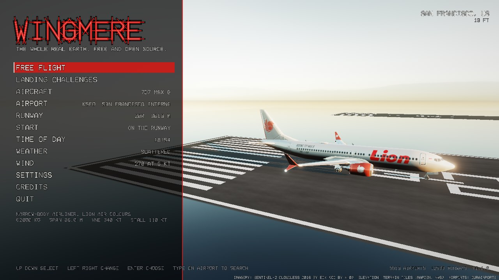
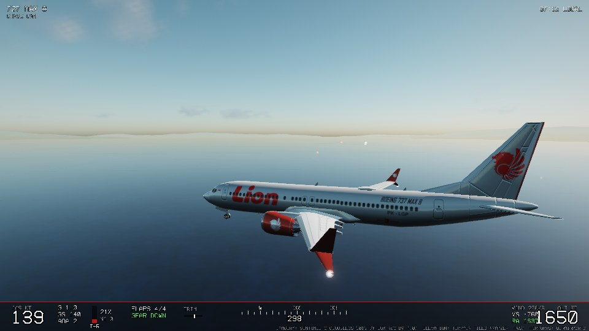
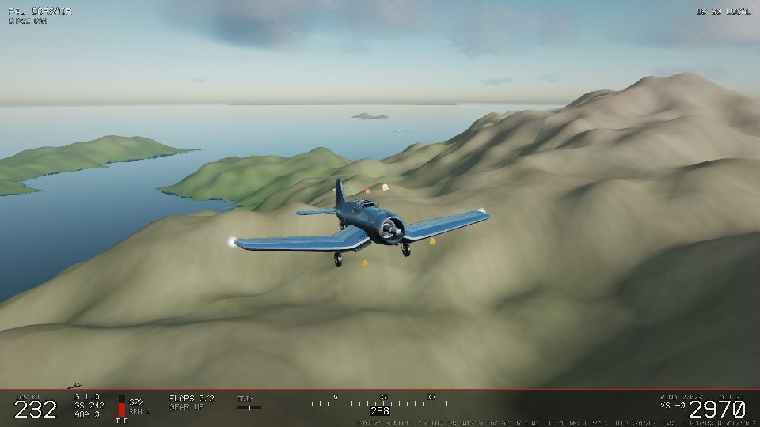
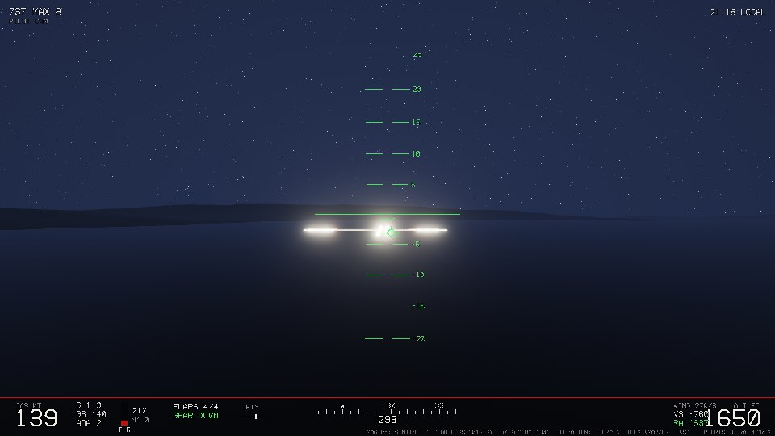
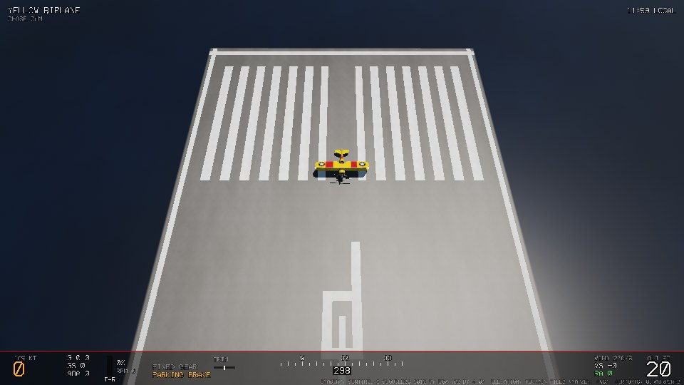

# WINGMERE

**A free, open-source flight simulator over the whole real Earth.** Pick any of 9,313 real airports, line up on a real runway and fly anywhere: satellite imagery and terrain elevation stream in while you fly and are cached on disk, every runway is painted on the ground with its real numbers, lights and PAPI, and the sky, sun, clouds and stars follow the real time of day.

Written in C with SDL2 and OpenGL 3.3, for every Linux distro. MIT licence.



| | |
|---|---|
|  |  |
|  |  |

*These were rendered on a build machine with no access to the tile servers, so the ground is the built-in offline world or a local test server. When online you get real Sentinel-2 satellite imagery and real terrain.*

## What's in it

- **The real planet, streamed.** A quadtree over the whole Earth in WGS84 double precision, with camera-relative rendering so there's no jitter anywhere, logarithmic depth for a 30 cm to 400 km view, and horizon culling. Imagery and elevation download on background threads, get cached in `~/.cache/wingmere`, and fall back to a procedural world when you're offline.
- **Every real airport.** 9,313 airports and 12,530 runways from OurAirports. Runways get centrelines, piano keys, aiming points, touchdown-zone bars and their real designators (28R, 09L…), the terrain under them is levelled, and at night the edge, threshold and approach lights come on, including a sequenced-strobe "rabbit". A PAPI shows white/red against your real glide angle.
- **Four aircraft**, each with its own flight model: Yellow Biplane, F4U Corsair, Airdrop Transport (four turboprops) and a 737 MAX 8.
- **Six-degrees-of-freedom flight model.** Lift with a real stall and post-stall, induced and transonic drag, flaps and gear drag, thrust that fades with speed and altitude, prop wash, stability derivatives, sprung, braked, steerable landing gear, wind with gusts and turbulence, and crash detection (hard landings, wingtip strikes, gear-up landings, ditching).
- **Graphics:** physically based aircraft materials with normal maps, a single-scattering atmosphere baked into a sky cubemap in your local frame, aerial perspective, raymarched volumetric cumulus, aircraft shadows on the ground, water with sky reflections and sun glint, stars, city lights at night, contrails above 8,200 m, tyre smoke, bloom, lens flare, eye adaptation and ACES tone mapping.
- **Landing challenges** scored out of 1,000 on sink rate, centreline, touchdown zone and alignment: Maho Beach, Lukla, Saba, Gibraltar, Madeira, Innsbruck, Paro, Queenstown, Aspen, San Francisco at dawn, Hong Kong at night, and a 22-knot crosswind at Heathrow. Best scores are saved.
- **Every touchdown is rated** (feet per minute, BUTTER to CARRIER STYLE), with distance past the threshold and centreline offset.
- **Glass-cockpit HUD** with a pitch ladder and flight-path marker in the pilot view, ILS-style localizer and glideslope to whichever runway you're lined up on, a terrain warning, stall horn, autopilot (heading, altitude, speed), a satellite map (M), six cameras, and all sound synthesised live (radial engines, turboprops, jets, wind, tyres).
- Keyboard, gamepad (SDL game controllers) and joystick/HOTAS (pitch, roll, throttle and rudder axes).

## Install

```sh
git clone https://github.com/rxvy-dev/wingmere
cd wingmere
./install.sh              # installs build dependencies, builds, installs to ~/.local
wingmere
```

`./install.sh --system` installs to `/usr/local`, and `--no-deps` skips the package step. The installer knows apt, dnf, pacman, xbps, zypper, apk, emerge and eopkg. To build by hand you need a C compiler, CMake, pkg-config and the development files for SDL2, OpenGL and libcurl:

```sh
cmake -S . -B build -DCMAKE_BUILD_TYPE=Release
cmake --build build -j
./build/wingmere          # finds ./data on its own
```

It needs a GPU with OpenGL 3.3. Scenery downloads the first time you fly over a place, usually a few tens of megabytes per area, and loads from the cache after that.

## Controls

| Key | Action |
|---|---|
| W S / ↑ ↓ | pitch (S pulls the nose up) |
| A D / ← → | roll |
| Q E | rudder and nosewheel steering |
| R F / PgUp PgDn | throttle; `1`–`9`, `0` set 10–100 %, `` ` `` idle |
| G | landing gear |
| V / B | flaps down / up |
| Space | brakes (Shift+Space toggles the parking brake) |
| , . | trim nose down / up |
| Z | autopilot on/off; while it's on, the flight controls adjust its targets |
| C, F2–F7 | cameras: chase, pilot, tail, orbit, tower, flyby |
| right mouse drag, wheel | look / orbit, zoom |
| M | map (+/- zoom) |
| P, Tab | pause, sim rate ×1/×2/×4 |
| T / Shift+T | time of day ±15 min |
| H, F3, F1 | hide HUD, FPS counter, controls help |
| F12 | screenshot to ~/Pictures |
| Esc | menu |

**Gamepad:** left stick flies, triggers set throttle, shoulder buttons are the rudder, A = gear, B = brakes, X/Y = flaps, D-pad = trim, Back = camera, Start = pause, left-stick click = autopilot.

**First flight:** pick FREE FLIGHT with the Corsair at KSFO. Press `0` for full power and the parking brake releases itself. Keep straight with Q/E, and at about 100 knots hold S to lift off. Press G to raise the gear.

## Command line

```
wingmere --airport LOWI --runway 26 --aircraft b737 --start approach --time 17.5 --weather 2 --wind 260/12 --fly
wingmere --challenge 1          # Maho Beach
wingmere --offline              # procedural world, no downloads
wingmere --help                 # everything else
```

## Settings

`~/.config/wingmere/wingmere.cfg` is written when you quit, or change something in SETTINGS. Things worth knowing:

```
detail = 1.0                 # terrain detail, 0.5 - 2.5
imagery_max_zoom = 14        # Sentinel-2 is 10 m per pixel, which is zoom 14
elevation_max_zoom = 12      # 13 gives sharper mountains, using more memory and downloads
texture_budget = 1536        # satellite tiles kept on the GPU
threads = 6                  # download threads
imagery_url = https://tiles.maps.eox.at/wmts/1.0.0/s2cloudless_3857/default/g/{z}/{y}/{x}.jpg
elevation_url = https://s3.amazonaws.com/elevation-tiles-prod/terrarium/{z}/{x}/{y}.png
```

The imagery and elevation sources are just URL templates (`{z}`, `{x}`, `{y}`). Point them at any Web-Mercator XYZ server you're allowed to use: imagery as JPEG/PNG, elevation in Terrarium encoding. `tools/fake_tile_server.py` serves an invented landscape locally, for testing.

## Adding aircraft

Each folder in `data/aircraft/` is one aircraft: `model.wmdl`, its textures, and `aircraft.cfg`, a plain text file with mass, wing area, lift and drag coefficients, thrust, stability derivatives, gear positions and speeds. `tools/build_aircraft.py` converts FBX models (through `tools/fbx2raw.c`, which uses ufbx) and writes all three. `tools/set_material.py` tweaks the paint on an existing model. `wingmere --test-flight` flies every aircraft headless and prints take-off roll, lift-off speed, climb time, top speed and stall speed, which helps when you're tuning.

## How it's built

| File | What it does |
|---|---|
| `src/tiles.c` | download threads, libcurl, disk cache, Terrarium/JPEG decoding, procedural fallback |
| `src/terrain.c` | whole-Earth quadtree, LOD, horizon/frustum culling, skirts, height queries, 2D map |
| `src/airport.c` | airports and runways, spatial grid, runway levelling |
| `src/flight.c` | 6-DOF flight model, gear, wind, crashes |
| `src/aircraft.c` | aircraft.cfg + WMDL loader, prop and gear animation |
| `src/render.c` | sky bake, shadows, HDR scene, clouds, bloom, composite, runway meshes and lights, effects |
| `src/hud.c` | built-in stroke font and 2D drawing (no font files) |
| `src/audio.c` | synthesised engine, wind, tyre and warning sounds |
| `src/main.c` | menus, input, cameras, autopilot, challenges, scoring, HUD layout |
| `shaders/wingmere.glsl` | every shader in one file. Run with `WINGMERE_SHADERS=shaders/wingmere.glsl` and press F5 to hot-reload |

## Credits and licences

The code is MIT, © 2026 rxvy. The data and models have their own licences, and **the attributions below must stay with any copy**. They also appear on the in-game CREDITS screen (`data/CREDITS.txt`) and as a line at the bottom of the screen.

- **Imagery:** [Sentinel-2 cloudless 2016](https://s2maps.eu) by EOX IT Services GmbH (contains modified Copernicus Sentinel data 2016 & 2017), CC BY 4.0. The EOX tile service is free for non-commercial use with attribution. Wingmere is free and non-commercial.
- **Elevation:** [Terrain Tiles on AWS](https://registry.opendata.aws/terrain-tiles/) (Mapzen), built from SRTM, GMTED2010, ETOPO1, NED, Canada CDEM, EU-DEM, Australia DEM, Mexico INEGI, Kartverket, LINZ and others. See their attribution page.
- **Airports and runways:** [OurAirports](https://ourairports.com/data/), public domain.
- **Aircraft models**, all CC BY 4.0. *Fill in the authors before publishing:*
  - Yellow Biplane: AUTHOR (link)
  - F4U Corsair: AUTHOR (link)
  - 737 MAX 8, Lion Air livery: AUTHOR (link)
  - Airdrop Transport (originally a Free Fire plane): AUTHOR (link)

  The models were re-oriented, scaled and re-materialled, and their textures were resized for the game.
- **Libraries:** SDL2 (zlib), libcurl (curl licence), stb_image and stb_image_write by Sean Barrett (public domain / MIT), ufbx by Samuli Raivio (MIT / public domain, used only by the converter tool).

Boeing, 737 and the Lion Air livery are trademarks of their owners. The Free Fire design belongs to Garena. Wingmere isn't affiliated with any of them, or with Microsoft.
